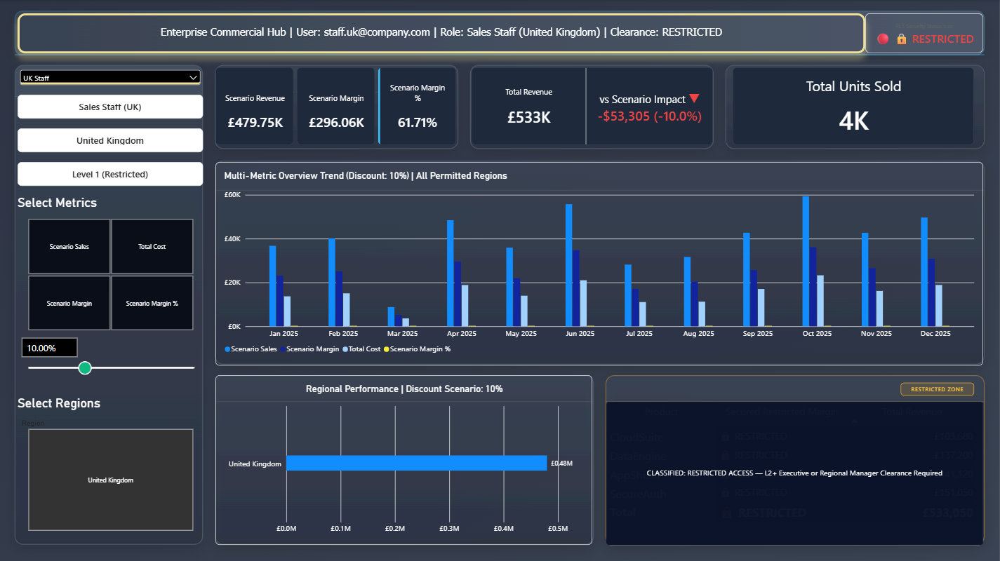
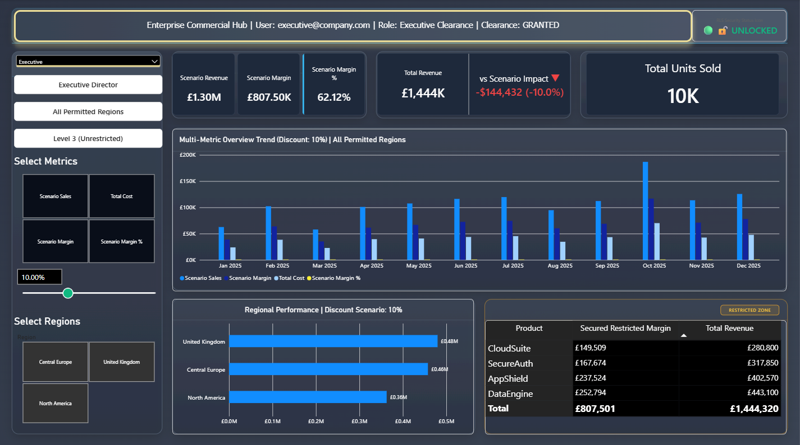
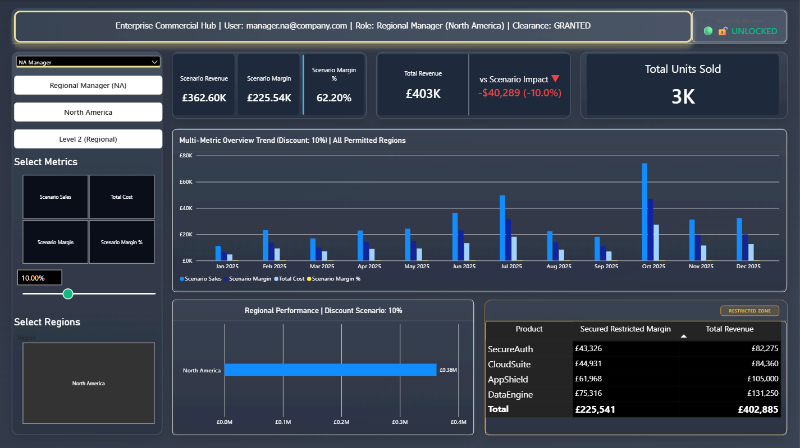

# Row-Level Security and What-If Scenario Dashboard — Power BI

A one-page Power BI dashboard that shows how the **same report can present different data to different people**. A persona selector switches between an Executive, a Regional Manager and a Sales Staff member, and the banner, KPIs, charts and a restricted margin table all respond to that user's role and region. A **what-if discount slider** lets the user test how a price cut changes revenue and margin.




*The screenshot shows the Sales Staff (UK) persona. The Restricted Zone table is masked because this role has Level 1 clearance.*

---

## What the dashboard demonstrates

- **Role-based views.** Three clearance levels: Level 1 (Restricted) for Sales Staff, Level 2 (Regional) for Regional Managers and Level 3 (Unrestricted) for Executives.
- **Region security.** A user only sees the regions they are allowed to see. The UK and North America managers each see one region, and the Executive sees all three.
- **A restricted zone.** The product margin table is masked for Level 1 users, with a "CLASSIFIED: RESTRICTED ACCESS" overlay. Managers and Executives see the full table.
- **A live governance banner.** The top bar shows the user, role and clearance, with a green UNLOCKED or red RESTRICTED status icon.
- **Dynamic titles.** Chart and table titles change with the discount scenario and the user's permitted regions.
- **A what-if discount parameter.** A slider (here set to 10%) recalculates Scenario Revenue, Scenario Margin and Scenario Margin % for the selected user.
- **A metric switcher (field parameter).** Buttons choose which measures the trend chart plots: Scenario Sales, Total Cost, Scenario Margin or Scenario Margin %.

## Headline numbers

Executive view (all regions) with a 10% discount scenario.

| KPI | Value |
|---|---|
| Total Revenue | **£1,444K** |
| Scenario Revenue (10% discount) | **£1.30M** |
| Scenario Margin | **£807.5K (62.1%)** |
| Impact of the discount on revenue | **−£144,432 (−10.0%)** |
| Units sold | **9,761** |

## Business insights from the data

- **The United Kingdom is the largest region** (£533K, 36.9% of revenue), narrowly ahead of Central Europe (£508K, 35.2%) and North America (£403K, 27.9%).
- **DataEngine and AppShield bring in over half of revenue.** DataEngine (£443K) and AppShield (£403K) lead, while SecureAuth (£318K) sells the most units (4,238) at a lower price.
- **October is the peak month** at £207.5K, about 14% of the year and almost three times January (£69.6K).
- **A 10% discount costs far more than 10% of margin.** Margin falls from £952K (65.9%) to £807.5K (62.1%), a 15% drop in margin pounds, because the discount comes straight off profit while costs stay the same.
- **Revenue is spread evenly across segments:** Enterprise £513K, Government £496K and Mid-Market £436K.

## Dashboard features

- **Persona selector** (Executive, North America Manager, UK Manager, UK Staff and others) that drives every visual
- **Governance banner** and **lock status icon** built from DAX
- **KPI cards** for Scenario Revenue, Scenario Margin, Scenario Margin %, Total Revenue, Variance vs Scenario and Total Units Sold
- **Multi-metric monthly trend** (clustered columns) with a dynamic title
- **Regional performance bar chart** limited to the regions the user may see
- **Restricted Zone table** by product that is masked with an overlay for Level 1 users
- **Discount what-if slider** and **metric field parameter**
- Custom dark theme with SVG icons for roles, padlocks and metrics

## What I did

1. **Modelled the data** with a sales fact table (`FactSales`), `DimRegion`, `DimDate` and a `DimUserSecurity` table that maps each user to a role and the regions they may access.
2. **Created a persona table** (`Demo_Personas`) so each role can be demonstrated in Power BI Desktop, alongside the security mapping.
3. **Built a what-if parameter** (`Discount Scenario`) and a **field parameter** (`Metric Parameter`).
4. **Wrote DAX measures** in a Key Measures table for the scenario figures, the governance banner, role and clearance text, dynamic titles, status colour and icon, region visibility and the restricted-zone overlay.
5. **Designed the layout** with a banner, a control panel, KPI cards, a trend chart, a regional chart and a masked table.

## Dataset

Synthetic data created for this demo. It contains no real people, companies or confidential information, and all email addresses are fictional.

| File | Description |
|---|---|
| [`data/FactSales.csv`](data/FactSales.csv) | 200 sales transactions in 2025 across 3 regions, 3 customer segments and 4 products: date, units, unit price, unit cost, revenue, total cost and margin |
| [`data/DimUserSecurity.csv`](data/DimUserSecurity.csv) | Maps user email to role (Staff, Manager, Executive) and allowed region |

## Repository structure

```
├── report/
│   └── RLS-Scenario-Dashboard.pbix     # Dashboard
├── data/
│   ├── FactSales.csv                   # Sales transactions
│   └── DimUserSecurity.csv             # User, role and region mapping
├── assets/                             # SVG icons and background used in the report
└── images/                             # Dashboard screenshots
```

## More screenshots




## How to open

1. Install [Power BI Desktop](https://www.microsoft.com/power-platform/products/power-bi/desktop) (free).
2. Download `report/RLS-Scenario-Dashboard.pbix` and open it.
3. Use the persona dropdown to switch between users, and move the discount slider to run scenarios.
4. If you are asked for the data source, point it to the files in `data/` and refresh.

---

Built by **Bukhtawar Ali** as part of the *AI-Powered Analytics with Power BI* course (EduHubSpot), 2026.
[LinkedIn](https://www.linkedin.com/in/bukhtawar-ali-4441291a9) · [Portfolio](https://bukhtawarali110.github.io) · [GitHub](https://github.com/BukhtawarAli110)
